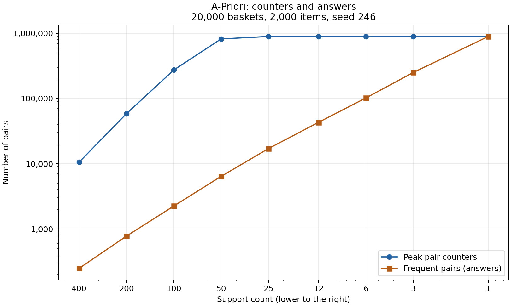

# Support를 낮추며 측정한 결과

## 실행 조건

- 실행일: 2026-10-27. Intel Core i9-9900KF 3.60GHz, 설치 RAM 32 GiB, 논리 CPU 16개.
- Windows 10 19045, Python 3.13.3. Whale 브라우저, 대화형 데스크톱 프로그램, Windows Defender와 일반 백그라운드 작업이 실행 중이었다.
- 기본 데이터: 항목 2,000개, 바구니 20,000개, 평균 길이 설정 20, seed 246. 제공된 생성기와 `PlainApriori`를 그대로 사용했다.
- 시간은 입력 생성 이후 `run()`만 측정했다. `tracemalloc`을 켠 시간이므로 `bench.txt`의 시간과 직접 비교하지 않았다.
- 추가 메모리는 `run()` 중 추적된 Python 할당의 최대값이다. 반환하는 결과 사전은 포함하지만, 미리 만든 입력 바구니와 추적기 자체의 메모리는 제외한다. MB는 1,000,000바이트다.

## 기본 데이터

| support | 빈발 항목 | 최대 쌍 카운터 | 빈발 쌍 | 직전 대비 카운터 | 시간(s) | 추가 메모리(MB) |
|---:|---:|---:|---:|---:|---:|---:|
| 400 | 146 | 10,585 | 249 | — | 1.038 | 1.06 |
| 200 | 345 | 58,626 | 776 | 5.54배 | 1.760 | 6.38 |
| 100 | 825 | 273,701 | 2,244 | 4.67배 | 3.232 | 26.39 |
| 50 | 1,849 | 820,259 | 6,397 | 3.00배 | 5.299 | 102.17 |
| 25 | 2,000 | 893,456 | 17,045 | 1.09배 | 4.982 | 102.17 |
| 12 | 2,000 | 893,456 | 43,116 | 1.00배 | 4.981 | 102.72 |
| 6 | 2,000 | 893,456 | 101,938 | 1.00배 | 5.158 | 119.36 |
| 3 | 2,000 | 893,456 | 250,054 | 1.00배 | 6.213 | 156.59 |
| 1 | 2,000 | 893,456 | 893,456 | 1.00배 | 8.125 | 327.02 |



400→200→100→50으로 낮출 때 카운터는 각각 5.54배, 4.67배, 3.00배가 됐다. 임계값을 절반으로 내렸다고 카운터가 두 배만 필요한 것은 아니었다. 25부터는 항목 2,000개가 모두 살아남아 카운터가 893,456개에서 멈췄다.

support 50에서는 카운터 820,259개로 정답 6,397개를 찾아 약 128.2배의 차이가 났다. 한 번이라도 나온 후보는 카운터를 가지지만 최종 support보다 작으면 답에서는 빠지기 때문이다. 초반에는 카운터 증가가 더 빨랐고, 후보가 포화된 뒤에는 정답만 늘었다. support 1에서는 관측된 모든 쌍이 정답이 되어 두 곡선이 만났다.

따라서 이 데이터에서 정답 수가 항상 더 느리게 증가한다고 할 수는 없다. 카운터가 같아진 뒤에도 반환할 정답 사전이 커져 support 1의 추가 메모리는 327.02 MB까지 늘었다. 기본 데이터는 support 1까지 완료됐고, 메모리 부족이나 중단은 없었다.

## 확장 데이터와 중단 지점

기본 데이터에서 한계에 닿지 않아 항목 10,000개, 바구니 40,000개, 평균 길이 설정 40, 같은 seed로 별도 실행했다. 실행 전에 알고리즘 30초 또는 작업 프로세스 working set 1 GiB를 중단 기준으로 정했다. 각 support는 새 작업 프로세스에서 실행했다.

| support | 상태 | 최대 쌍 카운터 | 빈발 쌍 | 시간(s) | 추적 할당 최대(MB) | 관측 working set 최대(MiB) |
|---:|---|---:|---:|---:|---:|---:|
| 400 | 완료 | 127,664 | 1,796 | 7.937 | 13.32 | 136.39 |
| 200 | 완료 | 687,824 | 5,123 | 15.029 | 61.22 | 240.50 |
| 100 | 완료 | 2,668,195 | 14,258 | 25.585 | 237.54 | 652.03 |
| 50 | 메모리 기준으로 중단 | 미확정 | 미확정 | 19.929 | 미확정 | 1024.88 |

support 50에서 관측 working set이 1,074,667,520바이트(약 1,024.88 MiB)에 도달해 중단했다. 감시 경과 시간은 19.93초로 시간 제한보다 메모리 기준이 먼저 걸렸다. 설치 RAM 32 GiB를 모두 썼거나 OOM이 발생한 것은 아니다. 중단된 조건의 최종 카운터와 답 개수는 알 수 없어 기록하지 않았다.

working set은 입력 생성과 추적기를 포함한 작업 프로세스 전체의 상주 메모리이며, 약 0.1초 간격으로 읽은 관측 최대값이다. 앞 표의 추가 할당량과 범위가 다르다. 완료 행의 시간은 작업 프로세스가 직접 쟀고, 중단 행은 부모 프로세스가 준비 신호를 받은 뒤 잰 감시 경과 시간이다.

## 다시 실행

기존 JSON에는 같은 조건을 덧붙이지 않도록 했다. 새로 측정하려면 기존 결과를 따로 보관한 뒤 실행한다.

```powershell
python task2_explosion.py --supports 400,200,100,50,25,12,6,3,1 --background "Whale browser, interactive desktop applications, Windows Defender and normal Windows background services"
python measure_boundary.py --seconds 30 --memory-mib 1024 --background "Whale browser, interactive desktop applications, Windows Defender and normal Windows background services"
python plot_explosion.py
```

`measure_boundary.py`의 working set 감시는 Windows 전용이다. 그래프 생성에는 matplotlib이 필요하다. 원래 측정값은 `explosion.json`, 확장 데이터 결과는 `boundary.json`, 실행 전 기준은 `experiment_plan.md`에 남겼다.
